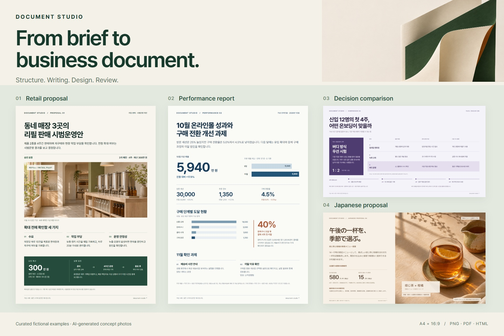

<h1 align="center">Document Studio</h1>
<p align="center"><strong>From brief to business document.</strong></p>
<p align="center">Reusable Codex skills for proposals, reports, and presentations.<br>Structure, writing, visual design, and review — with Japanese and Korean language modules.</p>

<p align="center"><a href="README.md">English</a> · <a href="README.ko.md">한국어</a> · <a href="README.ja.md">日本語</a></p>

<p align="center">
  <a href="https://github.com/wlehd00000-cell/document-studio/releases/tag/v0.1.0-alpha.6"></a>
  <a href="LICENSE"></a>
  <a href="docs/TECHNICAL_GUIDE.md"></a>
</p>

<p align="center"><a href="#quick-start">Quick start</a> · <a href="examples/document-collection/README.md">Explore the samples</a> · <a href="docs/README.md">Documentation</a></p>

<p align="center">
  <a href="examples/document-collection/README.md"></a>
</p>

## See the documents

Four finished, fictional examples. Open a full-size image, read the PDF, or inspect the editable HTML and copy.

| Document | What to look for | Files |
| :--- | :--- | :--- |
| **Retail pilot proposal** · Korean / A4 | Approval request, operating conditions, budget, and schedule | [PNG](examples/document-collection/png/01-refill-proposal.png) · [PDF](examples/document-collection/pdf/01-refill-proposal.pdf) · [HTML](examples/document-collection/html/01-refill-proposal.html) |
| **Monthly performance report** · Korean / A4 | Revenue comparison, purchase funnel, and follow-up actions | [PNG](examples/document-collection/png/02-commerce-report.png) · [PDF](examples/document-collection/pdf/02-commerce-report.pdf) · [HTML](examples/document-collection/html/02-commerce-report.html) |
| **Onboarding comparison** · Korean / 16:9 | Three options, a recommendation, and a four-week plan | [PNG](examples/document-collection/png/03-onboarding-comparison.png) · [PDF](examples/document-collection/pdf/03-onboarding-comparison.pdf) · [HTML](examples/document-collection/html/03-onboarding-comparison.html) |
| **Seasonal menu proposal** · Japanese / 16:9 | Product concept, trial conditions, pricing, and approval budget | [PNG](examples/document-collection/png/04-seasonal-menu-ja.png) · [PDF](examples/document-collection/pdf/04-seasonal-menu-ja.pdf) · [HTML](examples/document-collection/html/04-seasonal-menu-ja.html) |

Curated with a separate, author-maintained document workflow. All figures are fictional; store and product photos are AI-generated concepts. These are design examples, not a fresh-install benchmark of this package. [How the samples were made](examples/document-collection/README.md#production-notes)

## What the workflow adds

- **A structure for the decision.** Start with the reader, purpose, and requested action; build the page around them.
- **Writing that keeps its meaning.** Review wording alongside figures, assumptions, sources, and conditions. Add Japanese or Korean language review when needed.
- **Design you can revise.** Keep copy, numbers, and layout in HTML. Review the rendered pages before sharing or exporting.
- **Reusable company conventions.** An optional, human-approved Company Pack records terminology, writing, design, and source rules for later work.

The toolkit contains ten agent skills and supporting scripts. Your AI agent carries out the workflow in its own environment.

## Quick start

With **local Codex, Node.js 22.20+, and Git**, review the [skill instructions](skills/report-html-pptx/SKILL.md), then run this from your own project folder:

```bash
npx --yes skills add wlehd00000-cell/document-studio --skill '*' -a codex --copy -y
```

Start a new Codex session, confirm that `report-html-pptx` is available, and send:

```text
Use Document Studio to create a two-page A4 portrait HTML proposal
in English for a fictional employee onboarding pilot.

Reader: operations manager. Decision: approve a four-week pilot
for 12 new starters. Assumed budget: $2,400.
Page 1: problem, recommendation, and proposed approach.
Page 2: schedule, budget, three success measures, and risks.

Use the generic workflow, no Company Pack or real company files.
Mark all figures as fictional assumptions. Work in one-shot mode
without intermediate approval pauses. Deliver HTML only, with the
factual and visual checks actually completed; no PPTX for this trial.
```

The command copies the ten skills. It does not install an AI model, rendering dependencies, or a ChatGPT plugin. [Installation details and other routes](docs/TRY_FIRST.md)

## A workflow you can inspect

**Brief → structure & necessary research → writing & language review → HTML design → visual checks → requested export**

Start with HTML. If you need PowerPoint, the exporter reconstructs supported text, numbers, and shapes as editable elements. Photos and complex decoration may remain images; check the exported file in your target environment. [PowerPoint workflow](docs/PPTX_OUTPUT_ja.md) · [Skill architecture](docs/TECHNICAL_GUIDE.md)

## Use it your way

| Start with… | Guide |
| :--- | :--- |
| One document, no company setup | [First task and installation](docs/TRY_FIRST.md) |
| Japanese or Korean instructions | [日本語ガイド](docs/QUICKSTART_ja.md) · [한국어 가이드](docs/QUICKSTART_ko.md) |
| Your team's approved conventions | [Company Pack evaluation](docs/WORKSPACE_ADMIN_GUIDE.md) |
| More layout examples | [Earlier interactive showcase](docs/SHOWCASE.md) |
| Implementation and scripts | [Technical guide](docs/TECHNICAL_GUIDE.md) |

<details>
<summary><strong>Current scope · alpha.6</strong></summary>

- This is an experimental workflow toolkit. Output quality depends on the model, available tools, and review.
- The public Company Pack exporter supports fictional packs and distribution-authorized public sources. Private-source internal distribution is not supported.
- The four curated samples were checked as HTML, PNG, and PDF. They have not been exported or validated as editable PPTX.
- The hosted showcase displays static examples; it does not run an AI model.

[Release notes](docs/RELEASE_NOTES_ALPHA6.md) · [Installation scope](docs/TRY_FIRST.md) · [Sample provenance](examples/document-collection/README.md#production-notes)

</details>

## Help shape the next version

Try one document and [share what worked or where you got stuck](https://github.com/wlehd00000-cell/document-studio/issues/new?template=first_run.md). Japanese, Korean, and English are welcome. If this workflow is useful to you, a star helps others find it.

[Contributing](CONTRIBUTING.md) · [Changelog](CHANGELOG.md) · [Security](SECURITY.md) · [MIT license](LICENSE) · [Third-party notices](THIRD_PARTY_NOTICES.md)

An independent project. No employer or trademark-owner endorsement is implied.

<details>
<summary>Earlier documentation links</summary>

The detailed implementation reference is in the [technical guide](docs/TECHNICAL_GUIDE.md).

<a id="start-with-a-small-task"></a>
<a id="codex-install-the-agent-skills"></a>
<a id="chatgpt-use-the-starter-zip"></a>
<a id="first-prompt"></a>
<a id="what-makes-it-useful"></a>
<a id="quick-start--export-a-demo-plugin"></a>
<a id="how-it-works"></a>
<a id="who-is-it-for"></a>
<a id="whats-included-8-core-skills--2-optional-languages"></a>
<a id="what-works-today--and-what-does-not"></a>
<a id="curated-company-packs-phase-a"></a>
<a id="independent-public-source-evaluation-2026-10-29"></a>
<a id="analyze-and-distribute-an-organization-profile-experimental"></a>
<a id="default-visual-grammar-architecture-experimental-implementation"></a>
<a id="approved-layout-grammar--authored-html--browser-qa-experimental-alpha6"></a>
<a id="save-a-private-plugin-in-your-chatgpt-account"></a>
<a id="public-demo-safety"></a>
<a id="get-involved"></a>
<a id="license"></a>
<a id="attribution"></a>
<a id="fixed-rule-document-comparison"></a>
<a id="creative-example-and-optional-editorial-consulting"></a>
<a id="from-reviewed-html-to-editable-powerpoint"></a>

</details>
