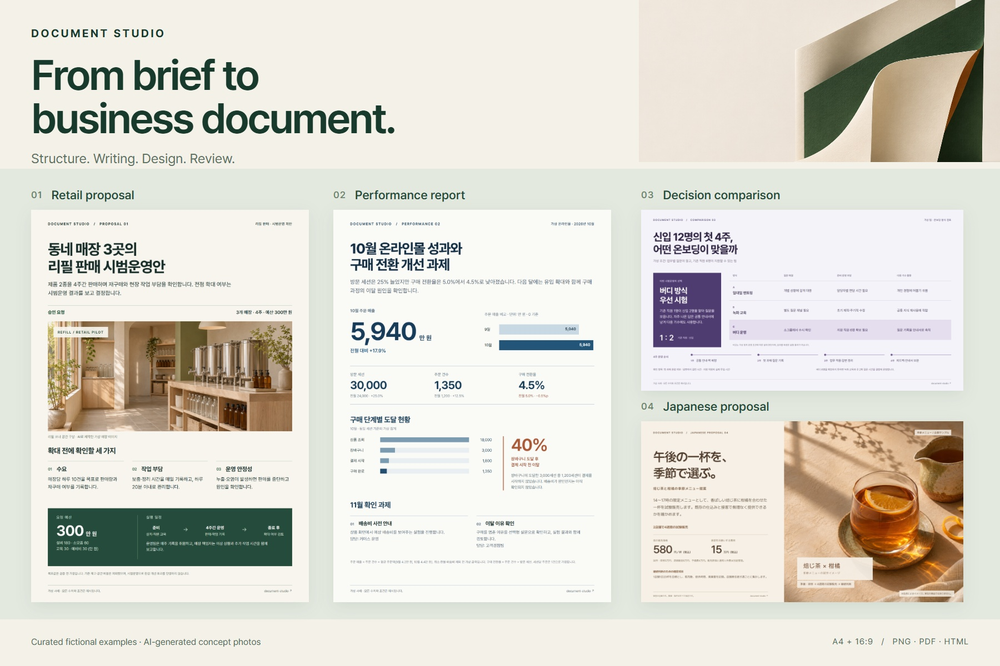

<h1 align="center">Document Studio</h1>
<p align="center"><strong>依頼から、伝わる業務文書へ。</strong></p>
<p align="center">提案書・報告書・プレゼン資料のためのCodexスキル集。<br>構成、執筆、デザイン、確認と、日本語・韓国語の推敲をつなぎます。</p>

<p align="center"><a href="README.md">English</a> · <a href="README.ko.md">한국어</a> · <a href="README.ja.md">日本語</a></p>

<p align="center">
  <a href="https://github.com/wlehd00000-cell/document-studio/releases/tag/v0.1.0-alpha.6"></a>
  <a href="LICENSE"></a>
  <a href="docs/TECHNICAL_GUIDE.md"></a>
</p>

<p align="center"><a href="#まず1件作ってみる">まず1件作る</a> · <a href="examples/document-collection/README.md">文書の作例</a> · <a href="docs/README.md">利用ガイド</a></p>

<p align="center">
  <a href="examples/document-collection/README.md"></a>
</p>

## まず、完成した文書を見る

異なる業務場面を想定した、架空の文書4点です。原寸の画像やPDFを開き、HTMLと原稿を保存して編集できます。

| 文書 | 見るポイント | ファイル |
| :--- | :--- | :--- |
| **リフィル販売の試行提案** · 韓国語 / A4 | 承認事項、運営条件、予算と日程 | [PNG](examples/document-collection/png/01-refill-proposal.png) · [PDF](examples/document-collection/pdf/01-refill-proposal.pdf) · [HTML](examples/document-collection/html/01-refill-proposal.html) |
| **オンラインストアの月次報告** · 韓国語 / A4 | 売上比較、購入過程の離脱と確認課題 | [PNG](examples/document-collection/png/02-commerce-report.png) · [PDF](examples/document-collection/pdf/02-commerce-report.pdf) · [HTML](examples/document-collection/html/02-commerce-report.html) |
| **新人受け入れ方式の比較** · 韓国語 / 16:9 | 3つの選択肢、推奨案と4週間の計画 | [PNG](examples/document-collection/png/03-onboarding-comparison.png) · [PDF](examples/document-collection/pdf/03-onboarding-comparison.pdf) · [HTML](examples/document-collection/html/03-onboarding-comparison.html) |
| **季節メニューの提案** · 日本語 / 16:9 | 商品案、試験販売の条件、価格と承認費用 | [PNG](examples/document-collection/png/04-seasonal-menu-ja.png) · [PDF](examples/document-collection/pdf/04-seasonal-menu-ja.pdf) · [HTML](examples/document-collection/html/04-seasonal-menu-ja.html) |

この作例は、制作者が別途管理する文書制作ワークフローで制作・推敲したものです。公開パッケージを新規導入して測定した性能試験ではありません。数値はすべて仮定で、店舗・飲料の写真はAI生成のコンセプトです。[制作・確認の範囲](examples/document-collection/README.md#production-notes)

## 文書づくりの手順を再利用する

- **判断につながる構成。** 読み手、目的、求める判断を整理してから、ページを組み立てます。
- **意味を保つ推敲。** 表現とともに数値・仮定・出典・条件を確認し、必要に応じて日本語・韓国語の校閲を適用します。
- **修正を続けられるデザイン。** 本文・数値・配置をHTMLで管理し、実際の表示を確認します。
- **チームで使う文書の基準。** 人が承認した用語・文体・デザイン・出典の規則を、任意のCompany Packにまとめます。

10個のエージェントスキルと補助スクリプトで構成され、利用先のAIエージェントが各工程を実行します。

## まず1件作ってみる

**ローカルCodex、Node.js 22.20以降、Git**を用意します。[スキルの作業指示](skills/report-html-pptx/SKILL.md)を確認したうえで、自分のプロジェクトフォルダから実行してください。

```bash
npx --yes skills add wlehd00000-cell/document-studio --skill '*' -a codex --copy -y
```

新しいCodexセッションで `report-html-pptx` が認識されることを確認し、次の依頼を送ります。

```text
Document Studioで、架空企業の新人受け入れ改善提案書を作成してください。
日本語のHTMLで2ページ、読むための文書としてA4縦を使います。

読者：業務責任者。求める判断：新人12名を対象とした4週間の試行の承認。
仮の予算：30万円。
1ページ目に課題・推奨案・運用方法、
2ページ目に日程・予算・評価指標3つ・リスクをまとめてください。

Company Packなしの一般的な工程で、実在企業の資料は使わず、
数値は仮定と明記してください。ワンショットで、途中の承認待ちをせず、
執筆・デザイン・実施可能な確認まで進めてください。
初回はHTMLのみを納品し、PPTXは作成しないでください。
内容と表示について、実際に確認した項目を添えてください。
```

このコマンドは10個のスキルをコピーします。AIモデル、出力に必要なツール、ChatGPTプラグインの登録は含みません。[導入の範囲と別の方法](docs/TRY_FIRST.md)

## 確認できる制作工程

**依頼の整理 → 構成・必要な調査 → 執筆・言語確認 → HTMLデザイン → 表示確認 → 指定形式への出力**

最初はHTMLで試せます。PowerPointが必要な場合は、対応する本文・数値・図形を編集可能な要素として組み直します。写真や複雑な装飾は画像として残る場合があるため、利用環境で出力を確認してください。[PowerPointの制作工程](docs/PPTX_OUTPUT_ja.md) · [スキル構成](docs/TECHNICAL_GUIDE.md)

## 目的に合わせて選ぶ

| 始めたいこと | ガイド |
| :--- | :--- |
| 会社設定なしで1件作る | [最初の依頼と導入](docs/TRY_FIRST.md) |
| 日本語・韓国語で手順を読む | [日本語ガイド](docs/QUICKSTART_ja.md) · [한국어 가이드](docs/QUICKSTART_ko.md) |
| チームの承認済みルールを使う | [Company Packの評価](docs/MANAGER_GUIDE_ja.md) |
| 別のレイアウトを比較する | [既存のインタラクティブ作例](docs/SHOWCASE.md) |
| 実装・スクリプトを確認する | [技術ガイド](docs/TECHNICAL_GUIDE.md) |

<details>
<summary><strong>現在の対応範囲 · alpha.6</strong></summary>

- 実験段階の文書制作ツールです。品質はモデル、利用可能なツール、確認作業によって変わります。
- 公開Company Packエクスポーターは、架空Packと配布権限を確認した公開資料に対応しています。非公開資料に基づく内部配布は未対応です。
- 新しい作例4点はHTML・PNG・PDFを確認しています。編集可能なPPTXへの変換・検証は行っていません。
- 紹介サイトは静的な例を表示し、AIを実行しません。

[リリース情報](docs/RELEASE_NOTES_ALPHA6.md) · [導入の範囲](docs/TRY_FIRST.md) · [作例の制作記録](examples/document-collection/README.md#production-notes)

</details>

## 使ってみた結果を教えてください

文書を1件作り、[できたこと・止まった箇所](https://github.com/wlehd00000-cell/document-studio/issues/new?template=first_run.md)をお寄せください。日本語・韓国語・英語で投稿できます。役に立ったら、Starでこのプロジェクトを広めていただけるとうれしいです。

[貢献する](CONTRIBUTING.md) · [変更履歴](CHANGELOG.md) · [セキュリティ](SECURITY.md) · [MITライセンス](LICENSE) · [第三者の権利表示](THIRD_PARTY_NOTICES.md)

個人が運営する独立プロジェクトです。勤務先や商標権者による導入・推奨を示すものではありません。
