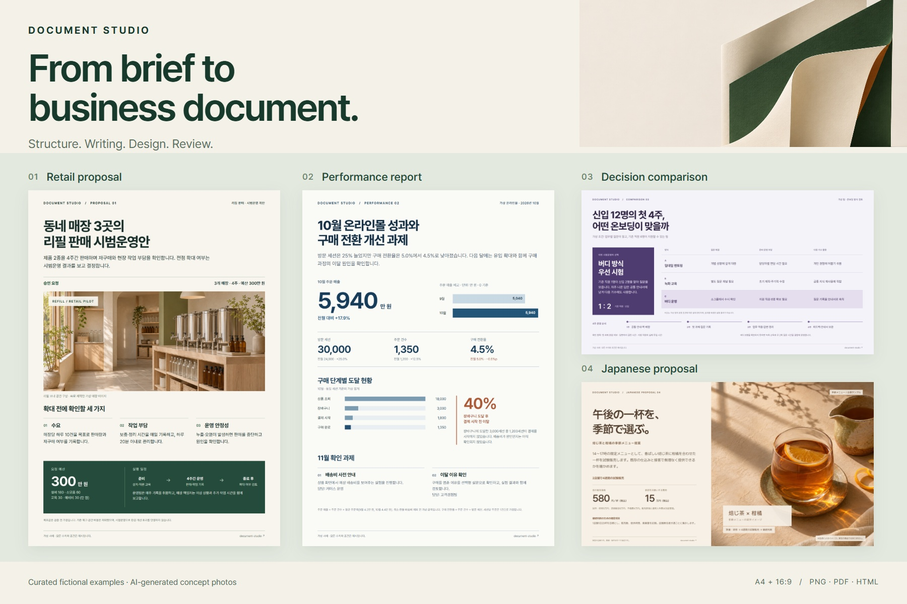

<h1 align="center">Document Studio</h1>
<p align="center"><strong>요청에서 완성된 업무 문서까지.</strong></p>
<p align="center">제안서·보고서·발표자료를 위한 Codex 스킬 모음.<br>구성, 집필, 시각 디자인, 검수와 한국어·일본어 교정을 하나의 흐름으로 연결합니다.</p>

<p align="center"><a href="README.md">English</a> · <a href="README.ko.md">한국어</a> · <a href="README.ja.md">日本語</a></p>

<p align="center">
  <a href="https://github.com/wlehd00000-cell/document-studio/releases/tag/v0.1.0-alpha.6"></a>
  <a href="LICENSE"></a>
  <a href="docs/TECHNICAL_GUIDE.md"></a>
</p>

<p align="center"><a href="#바로-시작하기">바로 시작하기</a> · <a href="examples/document-collection/README.md">문서 예시</a> · <a href="docs/README.md">사용 안내</a></p>

<p align="center">
  <a href="examples/document-collection/README.md"></a>
</p>

## 먼저 결과물을 살펴보세요

서로 다른 업무 상황을 담은 가상 문서 4종입니다. 원본 크기의 이미지와 PDF를 열거나, HTML과 원고를 내려받아 수정할 수 있습니다.

| 문서 | 확인할 내용 | 파일 |
| :--- | :--- | :--- |
| **리필 매장 제안서** · 한국어 / A4 | 승인 요청, 운영 조건, 예산과 일정 | [PNG](examples/document-collection/png/01-refill-proposal.png) · [PDF](examples/document-collection/pdf/01-refill-proposal.pdf) · [HTML](examples/document-collection/html/01-refill-proposal.html) |
| **온라인몰 성과 보고서** · 한국어 / A4 | 매출 비교, 구매 단계별 이탈과 후속 과제 | [PNG](examples/document-collection/png/02-commerce-report.png) · [PDF](examples/document-collection/pdf/02-commerce-report.pdf) · [HTML](examples/document-collection/html/02-commerce-report.html) |
| **온보딩 방식 비교** · 한국어 / 16:9 | 세 가지 방식, 선택 이유와 4주 계획 | [PNG](examples/document-collection/png/03-onboarding-comparison.png) · [PDF](examples/document-collection/pdf/03-onboarding-comparison.pdf) · [HTML](examples/document-collection/html/03-onboarding-comparison.html) |
| **계절 메뉴 제안** · 일본어 / 16:9 | 제품 구상, 시험판매 조건, 가격과 요청 예산 | [PNG](examples/document-collection/png/04-seasonal-menu-ja.png) · [PDF](examples/document-collection/pdf/04-seasonal-menu-ja.pdf) · [HTML](examples/document-collection/html/04-seasonal-menu-ja.html) |

이 예시는 제작자가 별도로 관리하는 문서 워크플로로 제작·교정한 문서입니다. 공개 패키지를 새로 설치해 측정한 성능시험 결과는 아닙니다. 수치는 모두 가상이며, 매장·음료 사진은 AI로 만든 콘셉트입니다. [제작·검수 범위](examples/document-collection/README.md#production-notes)

## 구성부터 검수까지

- **판단에 필요한 구성.** 독자, 목적, 요청할 결정을 먼저 정하고 그에 맞게 내용을 배치합니다.
- **의미를 지키는 문장.** 문구와 함께 수치·가정·출처·조건을 확인하고, 필요할 때 한국어·일본어 교정을 적용합니다.
- **계속 수정할 수 있는 디자인.** 본문·숫자·레이아웃을 HTML로 관리하고 실제 화면을 검수합니다.
- **팀에서 반복할 작성 기준.** 사람이 승인한 용어·문체·디자인·출처 규칙을 선택 사항인 Company Pack으로 관리합니다.

10개 에이전트 스킬과 보조 스크립트로 구성되어 있으며, 사용하는 AI 에이전트가 각 작업을 수행합니다.

## 바로 시작하기

**로컬 Codex, Node.js 22.20 이상, Git**이 필요합니다. [스킬의 작업 지침](skills/report-html-pptx/SKILL.md)을 확인한 뒤 자신의 프로젝트 폴더에서 실행하세요.

```bash
npx --yes skills add wlehd00000-cell/document-studio --skill '*' -a codex --copy -y
```

새 Codex 세션에서 `report-html-pptx`가 인식되는지 확인하고, 다음 요청문을 보내세요.

```text
Document Studio로 가상 기업의 신입 온보딩 개선 제안서를 만들어줘.
한국어 HTML 2페이지, 읽는 문서용 A4 세로야.

독자: 운영팀장. 요청할 결정: 신입 12명 대상 4주 시범운영 승인.
가상 예산: 300만 원.
1페이지에는 문제·제안·운영 방식을,
2페이지에는 일정·예산·성과지표 3개·위험요인을 담아줘.

Company Pack 없이 일반 워크플로를 사용하고 실제 기업 자료는 쓰지 마.
숫자는 가정임을 표시해. 원샷 모드로 중간 승인 대기 없이
집필·디자인·가능한 검수를 끝내줘. 첫 체험은 HTML만 제공하고
PPTX는 만들지 마. 실제로 수행한 내용·시각 검수를 함께 알려줘.
```

이 명령은 10개 스킬을 복사합니다. AI 모델, 출력에 필요한 도구, ChatGPT 플러그인은 별도로 준비해야 합니다. [설치 범위와 다른 설치 방법](docs/TRY_FIRST.md)

## 문서 제작 과정

**요청 정리 → 구성·필요한 조사 → 집필·언어 교정 → HTML 디자인 → 화면 검수 → 요청한 형식으로 출력**

처음에는 HTML로 시작하세요. PowerPoint가 필요하면 지원되는 본문·수치·도형을 편집 가능한 요소로 변환할 수 있습니다. 사진과 복잡한 장식은 이미지로 남을 수 있으므로 사용 환경에서 결과를 확인해야 합니다. [PowerPoint 제작 과정](docs/PPTX_OUTPUT_ja.md) · [스킬 구성](docs/TECHNICAL_GUIDE.md)

## 목적에 맞게 시작하세요

| 시작할 작업 | 안내 |
| :--- | :--- |
| 회사 설정 없이 문서 한 건 만들기 | [첫 사용과 설치](docs/TRY_FIRST.md) |
| 한국어·일본어로 사용 방법 읽기 | [한국어 가이드](docs/QUICKSTART_ko.md) · [日本語ガイド](docs/QUICKSTART_ja.md) |
| 팀의 승인된 작성 기준 적용하기 | [Company Pack 평가](docs/WORKSPACE_ADMIN_GUIDE.md) |
| 다른 문서 배치 비교하기 | [기존 인터랙티브 작례](docs/SHOWCASE.md) |
| 구현과 스크립트 확인하기 | [기술 안내](docs/TECHNICAL_GUIDE.md) |

<details>
<summary><strong>현재 지원 범위 · alpha.6</strong></summary>

- 실험 단계의 문서 제작 도구입니다. 결과는 모델, 사용 가능한 도구, 검수에 따라 달라집니다.
- 공개 Company Pack 출력 기능은 가상 Pack과 배포 권한이 확인된 공개 자료를 지원합니다. 비공개 자료를 바탕으로 한 내부 배포는 지원하지 않습니다.
- 새 예시 4종은 HTML·PNG·PDF를 확인했습니다. 편집 가능한 PPTX로 변환·검증한 자료는 아닙니다.
- 소개 사이트는 정적인 예시를 보여주며 AI를 실행하지 않습니다.

[릴리스 안내](docs/RELEASE_NOTES_ALPHA6.md) · [설치 범위](docs/TRY_FIRST.md) · [예시 제작 기록](examples/document-collection/README.md#production-notes)

</details>

## 써본 결과를 들려주세요

문서 한 건을 만들어 보고 [잘 된 점이나 막힌 단계](https://github.com/wlehd00000-cell/document-studio/issues/new?template=first_run.md)를 알려주세요. 한국어·일본어·영어 모두 괜찮습니다. 유용했다면 Star로 다른 사람에게도 알려주세요.

[기여 안내](CONTRIBUTING.md) · [변경 내역](CHANGELOG.md) · [보안](SECURITY.md) · [MIT 라이선스](LICENSE) · [제3자 권리 표시](THIRD_PARTY_NOTICES.md)

개인이 운영하는 독립 프로젝트이며, 소속 회사나 상표권자의 도입·추천을 뜻하지 않습니다.
