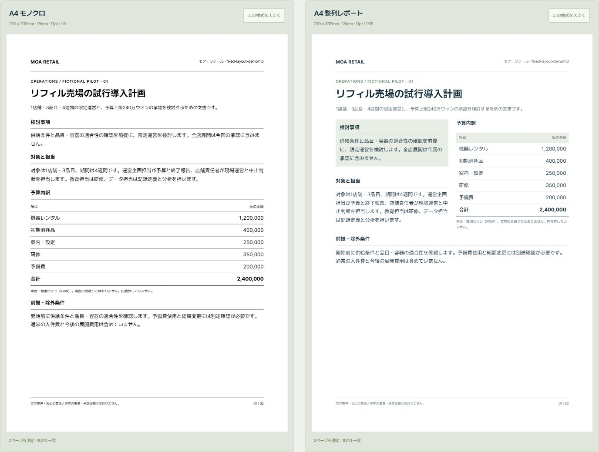

# Document Studio

**会社の文書基準を、AIの資料作成へ。**

参考資料から文体やデザインの特徴を整理し、人が確認したルールを次の資料作成で使うための、オープンソースのスキル集です。企業でAIをどう使うかを、文書業務から検証する個人の公開実験です。

[**日本語の紹介**](https://document-studio-public-experiment.wlehd00000.chatgpt.site/) · [**作例を選ぶ**](https://document-studio-public-experiment.wlehd00000.chatgpt.site/#examples) · [**導入ガイド**](docs/QUICKSTART_ja.md)

[한국어](README.ko.md) · [English / technical documentation](README.en.md)

[](https://document-studio-public-experiment.wlehd00000.chatgpt.site/compare)

## 作例で、3つの違いを確認

| 確かめたいこと | 見る例 | 閲覧 |
|---|---|---|
| 決めたルールを保つ | 同じ2ページを白黒A4・整列レポート・横型提案で比較。ページ・言語が変わっても余白・文字・色・数値整列を維持 | [固定ルールの比較](https://document-studio-public-experiment.wlehd00000.chatgpt.site/compare) |
| 読み手に合わせて構成する | 同じ案件を、企画提案書4ページ・決裁サマリー・業務ガイドへ | [目的別の文書](https://document-studio-public-experiment.wlehd00000.chatgpt.site/example?view=all&size=large) |
| 表現を大胆に変える | 実験的・没入型の設定で、要点を1ページに再編集した別案 | [創造性を広げた例](https://document-studio-public-experiment.wlehd00000.chatgpt.site/creative) |

日本語が標準で、韓国語へ切り替えられます。会社・目標・費用は仮定で、予算は**240万ウォン（KRW）**。画像は生成コンセプトです。作成済みの静的HTMLを表示しており、サイトではAIを実行しません。測定結果はこのHTML例に限り、生成の遵守率・実際の企業成果・印刷・PPTXを検証したものではありません。

[作例の原稿・規則・確認条件](showcase/README.md) · [全作例のHTMLを保存](https://document-studio-public-experiment.wlehd00000.chatgpt.site/downloads/document-studio-demo.zip)

## 参考資料から、次の文書まで

**利用権限のあるPDF・PPTX → 文体・デザインの特徴と根拠を整理 → 人がルールを確認 → Company Packで管理 → 新しい資料の作成**という流れです。

用語・文体、数値や出典、ブランドや指定様式の規則を保ちます。そのうえで章立てや説明方法を目的に合わせて決めます。固定レイアウトを指定した資料では、その配置ルールも守ります。作例の制作基準と、実在企業が承認したCompany Packは区別しています。

| 依頼の状態 | 進め方 |
|---|---|
| 原稿や目的が決まっている | 通常の制作で、調査・執筆・言語確認・デザイン・出力へ。創造性や画像の存在感は別途指定できます |
| 論点から相談したい | 任意の[深掘りコンサルティング企画](https://document-studio-public-experiment.wlehd00000.chatgpt.site/consulting)で、独立調査・反論・構成の代案を検討。方向性と最終原稿を確認してから本制作へ |

コンサルティング企画は明示的に選んだ場合に使います。通常のお任せ制作にこの相談工程を追加しません。[機能仕様](skills/report-html-pptx/references/editorial-consulting-mode.md)

## 小さな仕事を1件試す

### Codex

Node.js 22.20以降とGitが必要です。自分の作業フォルダーで実行してください。

```bash
npx --yes skills add wlehd00000-cell/document-studio --skill '*' -a codex --copy -y
```

この方法はスキルを配置します。Codexの新しいセッションで `report-html-pptx` が認識されるか確認してください。会社別パッケージの書き出しツールは、別途ソース全体が必要です。

### ChatGPT

[Starter ZIP（alpha.6）](https://github.com/wlehd00000-cell/document-studio/releases/download/v0.1.0-alpha.6/document-studio-starter-v0.1.0-alpha.6.zip)と、[日本語の導入ガイド](docs/QUICKSTART_ja.md)を参照してください。Plugin Creatorの作成機能と保存権限のあるアカウントが必要です。ZIPの保存だけではプラグインの導入は完了しません。

### 最初の依頼例

> 架空の小売企業の運営責任者が検討する、4週間の試行導入の企画提案書を、日本語のHTMLで作成してください。<br>
> 1店舗・3品目・予算上限240万ウォン（KRW）という仮定を維持してください。<br>
> 費用内訳、担当者、週別の計画、成功基準と中止条件を含めてください。<br>
> 仮定と実際に確認した事実を区別し、実施した確認と未確認の範囲を示してください。

文書の見た目に加え、数値、担当者、条件、実施した確認の範囲を見てください。表示中のデモと同じ出力になる保証はありません。

## 仕組みと現在の範囲

基本の流れは、**利用権限のある参考資料 → 特徴と根拠の抽出 → 人による確認・承認 → Company Pack → 新しい資料の作成**です。8つの基本スキルと、日本語・韓国語の2つの任意言語スキルを収録しています。

| 項目 | 現在の状態 |
|---|---|
| PDF・PPTXからの文体・デザイン分析、ルールの確認・承認 | 実装済みの実験機能。人による解釈と確認が必要 |
| 架空・公開配布の権限を確認したCompany Packの書き出し | 実装済み。登録・導入は別工程 |
| 非公開の社内資料を基にしたパックの内部配布 | 公開エクスポーターでは未対応・ブロック対象 |
| ワークスペースへの自動配布 | 未対応。権限のある管理者による導入が必要 |
| HTML・編集可能なPPTXの最終品質 | 執筆・表示・変換・目視確認をそれぞれ実施する必要あり |

実験段階のalpha版です。モデル間の同一品質、自動的なブランド再現、企業全体の生産性改善は保証していません。[技術説明とCLI](README.en.md) · [管理者向けの現在の制約](docs/WORKSPACE_ADMIN_GUIDE.md) · [変更履歴](CHANGELOG.md)

## 使った結果を共有

この方向に関心があれば、**[GitHubのStarで保存](https://github.com/wlehd00000-cell/document-studio)**してください。初回利用で作れた資料、修正が必要だった箇所、繰り返し伝えていた基準などを、[初回利用のフィードバック](https://github.com/wlehd00000-cell/document-studio/issues/new?template=first_run.md)で共有いただけると、次の検証につながります。

機密資料を含まない、公開可能な例を使用してください。[Contributing](CONTRIBUTING.md) · [Security](SECURITY.md)

## ライセンス

独自の成果物は[MIT](LICENSE)です。公開文書ビューに同梱するPretendard / Pretendard JPは、それぞれのOFLライセンス表示に従います。[第三者の権利表示](THIRD_PARTY_NOTICES.md)を参照してください。個人のオープンソースプロジェクトであり、勤務先や商標権者による導入・推奨・保証を示しません。
