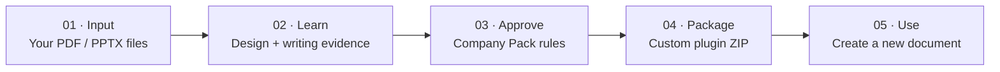

# Document Studio

### Turn your existing documents into a custom AI document plugin.

**An open-source toolkit for learning a company's document conventions and packaging them as a reusable ChatGPT plugin.** · English / 한국어 / 日本語

Give Document Studio **authorized PDF/PPTX references**, review the proposed writing and design rules, then export a company-aware plugin for yourself or a ChatGPT workspace. The generated plugin guides new reports and presentations using **approved** rules; source documents do not need to travel with the plugin.

> **Release status: v0.1.0-alpha.5 · Experimental.** The analysis, rule-approval and ZIP-export tools exist, but the reference-to-installed-plugin journey still has manual review and setup steps. Visual similarity, font licensing, PowerPoint rendering, and end-to-end browser QA are not certified. The fictional examples in this repository are independent materials. This is not an official product of, or affiliated with, any employer.

## From reference files to a new document — one workflow



| Scene | What you see | Current implementation |
|---|---|---|
| **01 · Input** | A manager provides representative reports, decks, and brand guidelines. | Authorized local PDF/PPTX ingestion; original files stay outside the public repository. |
| **02 · Learn** | Design, typography, layout relationships, and writing habits are extracted as reviewable evidence. | Extraction and evidence-based draft rule synthesis. |
| **03 · Approve** | A human accepts or rejects the proposed rules and approves a Company Pack. | Explicit review/approval is required; nothing is declared official automatically. |
| **04 · Package** | A tailored plugin is exported with the approved pack and selected language skills. | Privacy-audited ZIP export; installation/publishing happens separately. |
| **05 · Use** | A team member requests a fresh report and receives a document guided by the approved rules. | Existing document workflow and HTML production contracts; visual QA and PPTX output have environment-dependent requirements. |

**See the [end-to-end demo storyboard and reproducible commands](docs/DEMO_FLOW.md).** To preview the distinct fictional design profiles without uploading company material, start with [`demo-retail`](company-packs/demo-retail) and [`demo-manufacturing`](company-packs/demo-manufacturing).

**For workspace admins:** create and review the company profile once, then publish the exported plugin to your workspace. **For individuals:** use the same flow to build a personal document plugin. Workspace publication is controlled by the receiving account's admin settings; exporting a ZIP alone does not install or distribute a plugin.

## Skills (8 core + 2 optional)

| Skill | Role |
|---|---|
| `company-profile-analyzer` | Authorized PDF/PPTX analysis, source evidence, draft Company Pack synthesis and approval workflow |
| `report-html-pptx` | Intake, one-shot/collaborative routing, orchestration, QA |
| `document-research` | Evidence gathering and source notes |
| `document-architecture` | Argument, document structure and page plan |
| `document-writing` | Korean/Japanese business prose and synthetic style library |
| `document-design` | Editorial design and text/visual contracts |
| `visual-assets` | Diagram/image asset selection and provenance |
| `business-korean-translation` | Optional professional Korean adaptation |
| `business-japanese-translation` | Optional professional Japanese adaptation |
| `html-to-pptx` | Editable HTML → PowerPoint conversion and checks |

## Start

```bash
python scripts/install_local.py --verify-only
python scripts/install_local.py --language-skills none
# Or: --language-skills ko | ja | ko,ja
```

To preserve legacy behavior, omitting `--language-skills` installs both modules. `--language` chooses the installation guide language, not the installed modules.

## Curated Company Packs (Phase A)

Two fictional packs demonstrate color and writing isolation:

- `company-packs/demo-retail` — bright consumer-focused identity.
- `company-packs/demo-manufacturing` — restrained technical identity.

Validate a pack and produce an HTML scaffold with its design and writing settings:

```bash
python skills/report-html-pptx/scripts/validate_company_pack.py company-packs/demo-retail --require-approved
python skills/report-html-pptx/scripts/scaffold_report.py ./output/retail-pilot \
  --company-pack company-packs/demo-retail --language en-US \
  --genre proposal --interaction-mode one_shot \
  --audience 'Team leadership' --reader-action 'Decide on the pilot' \
  --output-format HTML --canvas widescreen --use reading
python skills/document-writing/scripts/find_writing_reference.py \
  --company-pack company-packs/demo-retail --language en-US \
  --document-family business_proposal --writing-function recommendation
```

An approved pack can still have unverified font rendering or usage rights. The scaffold writes `content/font-policy-review.json` and a content-addressed Company Pack snapshot, but does not certify a rendered result. Do not redistribute a font solely because a profile names it.

## Independent public-source evaluation (2026-10-29)

We tested official **Suntory** and **Seven & i Holdings** corporate PDF publications using first-two-page style inference and remaining-page color holdouts. The pipeline now captures PDF vector fill/stroke colors, builds reviewable draft packs, and produces source-text-free independent-content HTML style hypotheses. Exact color recurrence on holdouts was 25% and 75%, respectively; **these are not overall reconstruction-quality scores**. Original layouts, fonts, writing voice and editable PPTX output have **not** been faithfully reproduced or certified. See the [full method, official sources, per-company results and screenshots-based visual assessment](evaluation/public-company-fidelity-2026-10-29.md).

## Analyze and distribute an organization profile (experimental)

The analysis pipeline accepts authorized local PDF/PPTX files and maintains a separate private source registry. It extracts measurable layout and writing characteristics; it **does not automatically declare the company's official visual identity**. Use the analyzer's [source policy](skills/company-profile-analyzer/references/source-policy.md) and review workflow before a real company deployment.

### Default visual-grammar architecture (experimental implementation)

Each organization undergoes **one evidence-backed visual onboarding review**: measured page geometry and private rendered-page inspection → Brand DNA / Layout Grammar / Creative Vocabulary proposals → independently authored fictional-content style studies → explicit human rule decisions and Company Pack approval. Nearby role-labeled elements on a source page can produce conservative `above` / `left_of` relationship hypotheses. Salient PDF vectors are bounded and surfaced as togglable visual evidence; defective zero-area PDF images are quarantined. Later document work can retrieve the approved grammar for that organization, adapting layouts to new content rather than copying source pages. Changes to source evidence identify affected rules for re-review. The experimental `visual_grammar_workflow.py` CLI implements this evidence/review/retrieval path. Applying the grammar to authored HTML is a separate, review-gated stage described below; neither stage automatically composes professional-looking designs or certifies similarity to an official reference. See the [design specification](docs/superpowers/specs/2026-10-29-visual-grammar-onboarding-design.md), [test-first implementation plan](docs/superpowers/plans/2026-10-29-visual-grammar-onboarding.md), [P0 source regression](evaluation/visual-grammar-alpha4-p0-2026-10-29.md) and [operating workflow](skills/company-profile-analyzer/references/visual-grammar-onboarding.md).

### Approved Layout Grammar → authored HTML → browser QA (experimental alpha.5)

The approved [composition specification](docs/superpowers/specs/2026-10-29-approved-layout-grammar-composition-design.md) now has a Native, additive experimental implementation. Once the final manuscript and page decisions are approved, write `content/page-brief.json` with schema `layout-page-brief/1.0`. For each page supply its ID, family, reader question, element IDs and semantic roles, reading order, density, use, canvas, language and rights-checked assets. The plan step selects only individually accepted rules from an approved Company Pack, resolves explicit role relationships and reports conflicts instead of inventing a layout.

```bash
# The document project was scaffolded previously with the same approved Company Pack.
python skills/report-html-pptx/scripts/plan_layout_grammar.py \
  --project ./output/retail-pilot \
  --page-brief content/page-brief.json \
  --company-pack company-packs/demo-retail

# After the designer writes html/index.html using the precise plan element/rule IDs:
python skills/report-html-pptx/scripts/audit_layout_grammar.py \
  --project ./output/retail-pilot
```

Use `data-page-id`, `data-grammar-element-id` and `data-grammar-rule-ids` in the authored HTML. The static checker verifies traceability only. The browser checker measures actual bounding boxes, visibility, clipping and `above`/`left_of` relations, and records page screenshots and content hashes in `qa/layout-grammar-application.json`. It returns **`UNVERIFIED` if Chromium/Playwright is unavailable**, never a fabricated PASS. Final branded document delivery still requires a fresh passing browser check, human/visual review, existing production checks, and separately authorized brand assets. A passed DOM relation is **not** proof of beautiful design or faithful brand reconstruction.

Two independent, fictitious examples in `tests/fixtures/layout-grammar/` vary typography, geometry and illustration while sharing one accepted `heading above body` relation. They can be inspected without company-owned media. The browser-dependent acceptance test skips explicitly on systems without an installed Chromium executable; that environment remains a **release blocker**, not a verified success. See the [implementation plan](docs/superpowers/plans/2026-10-29-layout-grammar-composition-integration.md) and [acceptance status and release blockers](evaluation/layout-grammar-native-integration-2026-10-29.md).

```bash
# First register each source in a private working directory outside the repository.
python skills/company-profile-analyzer/scripts/source_registry.py ../document-studio-private/registry.json sample.pptx \
  --title 'Official presentation' --language en-US \
  --document-family executive_report --visibility public \
  --rights 'authorized for analysis; verify distribution separately'

python skills/company-profile-analyzer/scripts/document_extract.py sample.pptx \
  --output ../document-studio-private/extraction.json
python skills/company-profile-analyzer/scripts/design_analyzer.py ../document-studio-private/extraction.json \
  --source-id SRC_FROM_REGISTRY --document-family executive_report \
  --output ../document-studio-private/design.json
python skills/company-profile-analyzer/scripts/writing_analyzer.py ../document-studio-private/extraction.json \
  --source-id SRC_FROM_REGISTRY --language en-US \
  --document-family executive_report --output ../document-studio-private/writing.json
python skills/company-profile-analyzer/scripts/build_company_pack.py build \
  --registry ../document-studio-private/registry.json --design-analysis ../document-studio-private/design.json \
  --writing-analysis ../document-studio-private/writing.json --output ../document-studio-private/new-company \
  --pack-id new-company --company-name 'New Company' \
  --default-language en-US --enabled-language en-US
# The result is always DRAFT. Review and explicitly approve before production/export.
```

The public-only exporter uses a reviewed, approved pack. For example, a fictional pack with Japanese only:

```bash
python scripts/export_company_plugin.py \
  --company-pack company-packs/demo-retail \
  --language-skills ja --output ./dist/demo-retail-documents.zip
```

This ZIP includes the selected skills, a bundled Company Pack, installer and SHA-256 manifest. It excludes original company documents, disallowed fonts and unselected language modules. Public export of a real pack with private sources, no explicit per-source `distribution_authorized` confirmation, uncertain rights, or no separate review/approval record is refused. The current exporter intentionally has no private-package bypass.

### Save a private plugin in your ChatGPT account

To create an independent generic **Document Studio** plugin with both optional language modules:

```bash
python scripts/package_account_plugin.py --language-skills ko,ja \
  --output ../document-studio-account.zip
```

To tailor it to a **company**, use the approved Company Pack exporter shown above instead. In ChatGPT, install/select **Plugin Creator** on the target account, then ask it to create a private plugin from the absolute ZIP path. Plugin Creator saves to the currently authenticated personal account or active workspace according to account context. Its returned plugin URL and ID—not ZIP creation—confirm the save. Updates must target that exact plugin/release, never create duplicates. For the full approval and installation route, see [account installation](skills/company-profile-analyzer/references/account-installation.md).

Run tests with `python -m pytest tests/ -q` (install pytest in a development environment); refresh the manifest after editing files using `python scripts/build_package_manifest.py` and verify with `python scripts/build_package_manifest.py --check`.

See [START_HERE.md](START_HERE.md). To inspect independently authored examples, open `skills/report-html-pptx/assets/accepted-staff-guide/index.html` in a browser.

## Public-demo safety

- Fictional organizations A/B/C, fictional metrics and original SVG visuals only.
- No employer marks, internal documents, source-report text/excerpts, private project history or old validation evidence.
- No claims that synthetic casebook examples were measured from real publications.
- When generating real deliverables, independently verify evidence, sources and use rights.
- **Font binaries are not bundled** in this source-only edition. Install appropriately licensed Korean/Japanese fonts for precise visual QA; fallback typography may vary. Original strict font-embedding checks may require user-provided font assets.
- Editable PowerPoint output requires the optional converter's dependencies; merely cloning/installing skills does not install those dependencies or certify export.

## License

Original contributions in this repository are released under the [MIT License](LICENSE). Existing third-party files retain their own notices; see [THIRD_PARTY_NOTICES.md](THIRD_PARTY_NOTICES.md).

## Attribution

Independent open-source techniques and their license notices are retained where applicable. This is a personal open-source project, **not affiliated with or endorsed by any employer or trademark owner**.
