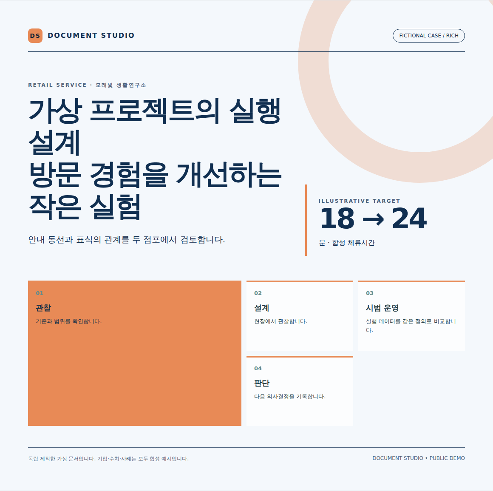
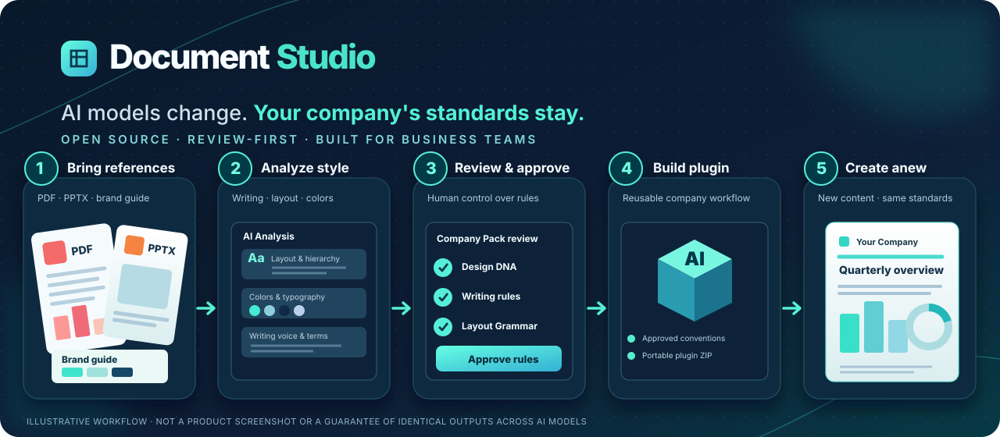

# Document Studio

**English** · [한국어 소개](docs/QUICKSTART_ko.md) · [日本語紹介](docs/QUICKSTART_ja.md)

### Reuse your document rules instead of rewriting the same AI prompt.

**Document Studio adds a repeatable research → writing → design → review workflow to document work, with optional Korean/Japanese business-writing skills.** Teams can also review document references and package approved company conventions for reuse.



*An included fictional document, rendered from [this HTML](skills/report-html-pptx/assets/accepted-staff-guide/index.html). [Image provenance](docs/assets/document-example.json). This is an example you can inspect, not a new-generation quality benchmark.*

It is an **MIT-licensed skills/plugin toolkit**, not a newly trained AI model. It runs inside a compatible AI agent; it is not a standalone website or a one-click PowerPoint generator.

**If you want reusable AI document workflows, [⭐ star Document Studio](https://github.com/wlehd00000-cell/document-studio) to bookmark the project and help others discover it.**

**[Start here: choose your installation route](docs/TRY_FIRST.md)** · [한국어 첫 사용](docs/TRY_FIRST.md#한국어) · [日本語ではじめる](docs/TRY_FIRST.md#日本語) · [Download alpha.6](https://github.com/wlehd00000-cell/document-studio/releases/tag/v0.1.0-alpha.6)

| You want to… | Start with… |
|---|---|
| Try it in ChatGPT, without a terminal | [Starter ZIP + Plugin Creator instructions](docs/TRY_FIRST.md#chatgpt). Requires an eligible account with Plugin Creator/create permission. |
| Use the skills with a local Codex environment | [Local installation](docs/TRY_FIRST.md#local-codex). Python installs the skills; the AI environment handles authoring. |
| Evaluate a company-specific setup | [Fictional retail demo](docs/TRY_FIRST.md#company-demo). Begin with the included approved fictional pack. |
| Inspect implementation before installing | [Architecture and workflow](docs/DEMO_FLOW.md) · [Source](skills/) |

**First task:** create a two-page proposal for a fictional employee onboarding pilot. [Copy a complete brief and see what to check](docs/TRY_FIRST.md#first-task). You do not need company files to start.

[](LICENSE)  

> **Alpha scope:** downloading is not installing. Account eligibility varies. Private/restricted company-source packs cannot currently be exported; final document authoring and visual checks remain separate steps. [Full installation details and limits](docs/DOWNLOAD_AND_INSTALL.md).



*Workflow illustration, not an output screenshot. [Star the repository](https://github.com/wlehd00000-cell/document-studio) to follow the project, or [report your first run](https://github.com/wlehd00000-cell/document-studio/issues/new?template=first_run.md).*

## The problem isn't just generating documents. It's keeping them consistent.

Imagine three employees preparing the same executive update with different prompts or AI model versions. The content may be useful, but the tone, terminology, page structure, and brand treatment can drift. Rewriting a clever prompt every time is not a reliable organization-wide document standard.

**Our approach is to separate the organization's approved rules from the changing AI workflow.** A Company Pack records reviewable writing and design conventions; document-production skills use those conventions during new work, and QA catches specific structural failures.

| What may change | What the organization keeps under review and control |
|---|---|
| AI model or model version | Approved writing conventions, terminology, and layout relationships |
| Employee or prompt wording | Reusable Company Pack and document workflow |
| Document topic or audience | Shared quality gates, source provenance, and human approval |
| Visual composition | Brand principles and allowed creative variation — **not** a single frozen slide template |

**Important:** this is a *standards and governance approach*, not a guarantee of identical output across models. The current plugin is built for ChatGPT; cross-provider portability, deterministic visual equivalence, and automatic revalidation after model upgrades have **not** been certified.

## Why Document Studio?

Most AI writing tools begin with a blank prompt or a fixed template. Document Studio starts with **the documents your organization already trusts** and turns their observable conventions into reviewable, reusable rules. Human approval is part of the workflow so the company — not an accidental prompt — defines the standard.

| Bring your materials | Keep control | Reuse the result |
|---|---|---|
| Analyze **authorized PDFs and PowerPoint decks** for writing and visual characteristics. | Review source evidence, font and asset rights, and proposed layout rules **before approval**. | Export an approved **public-authorized Company Pack + plugin bundle**; private distribution is on the roadmap. |

**What makes it different:** organization-owned Company Packs, evidence-backed Layout Grammar, explicit human approval, Korean/Japanese optional language modules, and testable production contracts. The aim is **consistent standards with room for creative layouts**, not perfect visual cloning or the same pixels every time.

## Quick start — export a demo plugin

Try the complete **packaging step** with an independently authored, fictional retail company. You do **not** need to upload real company documents or possess any company credentials for this example.

```bash
git clone https://github.com/wlehd00000-cell/document-studio.git
cd document-studio
python scripts/install_local.py --verify-only
python scripts/export_company_plugin.py \
  --company-pack company-packs/demo-retail \
  --language-skills ko,ja \
  --output ./dist/demo-retail-documents.zip
```

**Result:** `dist/demo-retail-documents.zip`—a tailored plugin package containing the approved fictional Company Pack and selected skills. **This command exports a ZIP; it does not install a plugin into ChatGPT.** For installation, use [Plugin Creator/account instructions](skills/company-profile-analyzer/references/account-installation.md) or the [workspace admin guide](docs/WORKSPACE_ADMIN_GUIDE.md).

To make a **new company plugin from your own files**, follow the [five-scene reference-to-plugin walkthrough](docs/DEMO_FLOW.md). The source-analysis and review steps are intentionally separate from packaging.

## How it works

1. **Reference.** Register authorized PDF/PPTX files privately and extract measurable design and writing characteristics.
2. **Review.** Inspect the draft Company Pack, reject or accept proposed rules, and approve permitted assets and language conventions.
3. **Package.** Export an approved public-authorized Company Pack as a customized plugin ZIP—not the original source documents. A private-source pack is currently blocked.
4. **Deploy.** Install it personally or have a workspace administrator publish the plugin to their organization.
5. **Create.** Ask the installed plugin for a **new** report or presentation; inspect the output and its applicable QA status.

**For workspace administrators:** pilot the workflow once, review the rules as an organizational asset, and distribute the resulting custom plugin only through an approved installation path. When the AI environment changes, review compatibility and QA instead of silently treating previous approval as proof of equivalent new output.

The two included fictional profiles—[`demo-retail`](company-packs/demo-retail) and [`demo-manufacturing`](company-packs/demo-manufacturing)—demonstrate that the same workflow can use different approved settings.

## Who is it for?

| Role | Starting point | Outcome |
|---|---|---|
| **Workspace admin / DX team** | Authorized public examples today; separately approved private materials in a future workflow | Pilot a company-specific plugin with fictional/public-authorized materials before considering wider deployment. |
| **Employee** | An installed organization plugin and a new document brief | Work from the approved writing and layout conventions without repeating onboarding. |
| **Individual creator** | Your own authorized portfolio, reports, or presentation files | Analyze and review your style privately; currently export a plugin only when its derived pack meets the public-distribution checks. |

**Privacy is part of the workflow:** keep source files and private registries outside the open-source checkout. The exporter rejects disallowed assets and lacks a bypass for unauthorized distribution. Review your organization's handling policies before uploading sensitive files to any AI service.

## What's included (8 core skills + 2 optional languages)

| Skill | Role |
|---|---|
| `company-profile-analyzer` | Authorized PDF/PPTX analysis, source evidence, draft Company Pack synthesis and approval workflow |
| `report-html-pptx` | Intake, one-shot/collaborative routing, orchestration, QA |
| `document-research` | Evidence gathering and source notes |
| `document-architecture` | Argument, document structure and page plan |
| `document-writing` | Korean/Japanese business prose and synthetic style library |
| `document-design` | Editorial design and text/visual contracts |
| `visual-assets` | Diagram/image asset selection and provenance |
| `business-korean-translation` | Optional professional Korean adaptation |
| `business-japanese-translation` | Optional professional Japanese adaptation |
| `html-to-pptx` | Editable HTML → PowerPoint conversion and checks |

For a local skill installation rather than the demo plugin export, use `python scripts/install_local.py --language-skills none` (core only), or `--language-skills ko`, `ja`, or `ko,ja`. Omitting the flag preserves the legacy default of including both optional language modules.

## What works today — and what does not

| Capability | Alpha.6 status |
|---|---|
| Extract PDF/PPTX design and writing evidence | <strong>Implemented</strong>, with human interpretation required |
| Review and approve a Company Pack / Layout Grammar | <strong>Implemented</strong>, with explicit review steps |
| Export a fictional or separately authorized public-distribution pack | <strong>Implemented</strong>; reproducible CLI demo above |
| Export a pack built from private/restricted company documents for internal-only distribution | **Not supported**; blocked by the public exporter |
| Automatically install/publish into a ChatGPT Business workspace | **Not supported**; administrator performs deployment |
| Automatically deliver a visually verified new HTML/PPTX from uploaded references | **Not supported end-to-end**; authoring and browser QA remain separate |

The goal is **organization-scale consistency across people and changing AI workflows**, backed by human review — not an assertion of provider-independent, model-proof output or a finished enterprise deployment system. See the [workshop-ready demo storyboard](docs/DEMO_FLOW.md) and [current release limits](docs/WORKSPACE_ADMIN_GUIDE.md).

## Curated Company Packs (Phase A)

Two fictional packs demonstrate color and writing isolation:

- `company-packs/demo-retail` — bright consumer-focused identity.
- `company-packs/demo-manufacturing` — restrained technical identity.

Validate a pack and produce an HTML scaffold with its design and writing settings:

```bash
python skills/report-html-pptx/scripts/validate_company_pack.py company-packs/demo-retail --require-approved
python skills/report-html-pptx/scripts/scaffold_report.py ./output/retail-pilot \
  --company-pack company-packs/demo-retail --language en-US \
  --genre proposal --interaction-mode one_shot \
  --audience 'Team leadership' --reader-action 'Decide on the pilot' \
  --output-format HTML --canvas widescreen --use reading
python skills/document-writing/scripts/find_writing_reference.py \
  --company-pack company-packs/demo-retail --language en-US \
  --document-family business_proposal --writing-function recommendation
```

An approved pack can still have unverified font rendering or usage rights. The scaffold writes `content/font-policy-review.json` and a content-addressed Company Pack snapshot, but does not certify a rendered result. Do not redistribute a font solely because a profile names it.

## Independent public-source evaluation (2026-10-29)

We tested official **Suntory** and **Seven & i Holdings** corporate PDF publications using first-two-page style inference and remaining-page color holdouts. The pipeline now captures PDF vector fill/stroke colors, builds reviewable draft packs, and produces source-text-free independent-content HTML style hypotheses. Exact color recurrence on holdouts was 25% and 75%, respectively; **these are not overall reconstruction-quality scores**. Original layouts, fonts, writing voice and editable PPTX output have **not** been faithfully reproduced or certified. See the [full method, official sources, per-company results and screenshots-based visual assessment](evaluation/public-company-fidelity-2026-10-29.md).

## Analyze and distribute an organization profile (experimental)

The analysis pipeline accepts authorized local PDF/PPTX files and maintains a separate private source registry. It extracts measurable layout and writing characteristics; it **does not automatically declare the company's official visual identity**. Use the analyzer's [source policy](skills/company-profile-analyzer/references/source-policy.md) and review workflow before a real company deployment.

### Default visual-grammar architecture (experimental implementation)

Each organization undergoes **one evidence-backed visual onboarding review**: measured page geometry and private rendered-page inspection → Brand DNA / Layout Grammar / Creative Vocabulary proposals → independently authored fictional-content style studies → explicit human rule decisions and Company Pack approval. Nearby role-labeled elements on a source page can produce conservative `above` / `left_of` relationship hypotheses. Salient PDF vectors are bounded and surfaced as togglable visual evidence; defective zero-area PDF images are quarantined. Later document work can retrieve the approved grammar for that organization, adapting layouts to new content rather than copying source pages. Changes to source evidence identify affected rules for re-review. The experimental `visual_grammar_workflow.py` CLI implements this evidence/review/retrieval path. Applying the grammar to authored HTML is a separate, review-gated stage described below; neither stage automatically composes professional-looking designs or certifies similarity to an official reference. See the [design specification](docs/superpowers/specs/2026-10-29-visual-grammar-onboarding-design.md), [test-first implementation plan](docs/superpowers/plans/2026-10-29-visual-grammar-onboarding.md), [P0 source regression](evaluation/visual-grammar-alpha4-p0-2026-10-29.md) and [operating workflow](skills/company-profile-analyzer/references/visual-grammar-onboarding.md).

### Approved Layout Grammar → authored HTML → browser QA (experimental alpha.6)

The approved [composition specification](docs/superpowers/specs/2026-10-29-approved-layout-grammar-composition-design.md) now has a Native, additive experimental implementation. Once the final manuscript and page decisions are approved, write `content/page-brief.json` with schema `layout-page-brief/1.0`. For each page supply its ID, family, reader question, element IDs and semantic roles, reading order, density, use, canvas, language and rights-checked assets. The plan step selects only individually accepted rules from an approved Company Pack, resolves explicit role relationships and reports conflicts instead of inventing a layout.

```bash
# The document project was scaffolded previously with the same approved Company Pack.
python skills/report-html-pptx/scripts/plan_layout_grammar.py \
  --project ./output/retail-pilot \
  --page-brief content/page-brief.json \
  --company-pack company-packs/demo-retail

# After the designer writes html/index.html using the precise plan element/rule IDs:
python skills/report-html-pptx/scripts/audit_layout_grammar.py \
  --project ./output/retail-pilot
```

Use `data-page-id`, `data-grammar-element-id` and `data-grammar-rule-ids` in the authored HTML. The static checker verifies traceability only. The browser checker measures actual bounding boxes, visibility, clipping and `above`/`left_of` relations, and records page screenshots and content hashes in `qa/layout-grammar-application.json`. It returns **`UNVERIFIED` if Chromium/Playwright is unavailable**, never a fabricated PASS. Final branded document delivery still requires a fresh passing browser check, human/visual review, existing production checks, and separately authorized brand assets. A passed DOM relation is **not** proof of beautiful design or faithful brand reconstruction.

Two independent, fictitious examples in `tests/fixtures/layout-grammar/` vary typography, geometry and illustration while sharing one accepted `heading above body` relation. They can be inspected without company-owned media. The browser-dependent acceptance test skips explicitly on systems without an installed Chromium executable; that environment remains a **release blocker**, not a verified success. See the [implementation plan](docs/superpowers/plans/2026-10-29-layout-grammar-composition-integration.md) and [acceptance status and release blockers](evaluation/layout-grammar-native-integration-2026-10-29.md).

```bash
# First register each source in a private working directory outside the repository.
python skills/company-profile-analyzer/scripts/source_registry.py ../document-studio-private/registry.json sample.pptx \
  --title 'Official presentation' --language en-US \
  --document-family executive_report --visibility public \
  --rights 'authorized for analysis; verify distribution separately'

python skills/company-profile-analyzer/scripts/document_extract.py sample.pptx \
  --output ../document-studio-private/extraction.json
python skills/company-profile-analyzer/scripts/design_analyzer.py ../document-studio-private/extraction.json \
  --source-id SRC_FROM_REGISTRY --document-family executive_report \
  --output ../document-studio-private/design.json
python skills/company-profile-analyzer/scripts/writing_analyzer.py ../document-studio-private/extraction.json \
  --source-id SRC_FROM_REGISTRY --language en-US \
  --document-family executive_report --output ../document-studio-private/writing.json
python skills/company-profile-analyzer/scripts/build_company_pack.py build \
  --registry ../document-studio-private/registry.json --design-analysis ../document-studio-private/design.json \
  --writing-analysis ../document-studio-private/writing.json --output ../document-studio-private/new-company \
  --pack-id new-company --company-name 'New Company' \
  --default-language en-US --enabled-language en-US
# The result is always DRAFT. Review and explicitly approve before production/export.
```

The public-only exporter uses a reviewed, approved pack. For example, a fictional pack with Japanese only:

```bash
python scripts/export_company_plugin.py \
  --company-pack company-packs/demo-retail \
  --language-skills ja --output ./dist/demo-retail-documents.zip
```

This ZIP includes the selected skills, a bundled Company Pack, installer and SHA-256 manifest. It excludes original company documents, disallowed fonts and unselected language modules. Public export of a real pack with private sources, no explicit per-source `distribution_authorized` confirmation, uncertain rights, or no separate review/approval record is refused. The current exporter intentionally has no private-package bypass.

### Save a private plugin in your ChatGPT account

To create an independent generic **Document Studio** plugin with both optional language modules:

```bash
python scripts/package_account_plugin.py --language-skills ko,ja \
  --output ../document-studio-account.zip
```

To tailor it to a **company**, use the approved Company Pack exporter shown above instead. In ChatGPT, install/select **Plugin Creator** on the target account, then ask it to create a private plugin from the absolute ZIP path. Plugin Creator saves to the currently authenticated personal account or active workspace according to account context. Its returned plugin URL and ID—not ZIP creation—confirm the save. Updates must target that exact plugin/release, never create duplicates. For the full approval and installation route, see [account installation](skills/company-profile-analyzer/references/account-installation.md).

Run tests with `python -m pytest tests/ -q` (install pytest in a development environment); refresh the manifest after editing files using `python scripts/build_package_manifest.py` and verify with `python scripts/build_package_manifest.py --check`.

See [START_HERE.md](START_HERE.md). To inspect independently authored examples, open `skills/report-html-pptx/assets/accepted-staff-guide/index.html` in a browser.

## Public-demo safety

- Fictional organizations A/B/C, fictional metrics and original SVG visuals only.
- No employer marks, internal documents, source-report text/excerpts, private project history or old validation evidence.
- No claims that synthetic casebook examples were measured from real publications.
- When generating real deliverables, independently verify evidence, sources and use rights.
- **Font binaries are not bundled** in this source-only edition. Install appropriately licensed Korean/Japanese fonts for precise visual QA; fallback typography may vary. Original strict font-embedding checks may require user-provided font assets.
- Editable PowerPoint output requires the optional converter's dependencies; merely cloning/installing skills does not install those dependencies or certify export.

## Get involved

- **Try it:** run the fictional Quick Start above, then follow the [five-scene demo plan](docs/DEMO_FLOW.md). Share reproducible feedback with no confidential materials.
- **Improve it:** [open a feature request or bug report](https://github.com/wlehd00000-cell/document-studio/issues/new/choose), or read [CONTRIBUTING.md](CONTRIBUTING.md) before a pull request.
- **Bring it to a workspace:** follow the [administrator pilot checklist](docs/WORKSPACE_ADMIN_GUIDE.md) and pin a reviewed version.
- **Track the honest scope:** see the [changelog](CHANGELOG.md) and [security policy](SECURITY.md). Private-source internal-only export is a priority roadmap item, not a shipped feature.

For maintainers introducing the project publicly, the [launch kit](docs/LAUNCH_CHECKLIST.md) contains a model-change/brand-consistency positioning guide, the social-preview asset, and English/Korean/Japanese announcement drafts. **No promotional video is included in this release.**

If this solves a real onboarding problem for your team, **star the repository** so others looking for reviewable document automation can find it. You can also share a short, reproducible example or an issue report.

## License

Original contributions in this repository are released under the [MIT License](LICENSE). Existing third-party files retain their own notices; see [THIRD_PARTY_NOTICES.md](THIRD_PARTY_NOTICES.md).

## Attribution

Independent open-source techniques and their license notices are retained where applicable. This is a personal open-source project, **not affiliated with or endorsed by any employer or trademark owner**.
