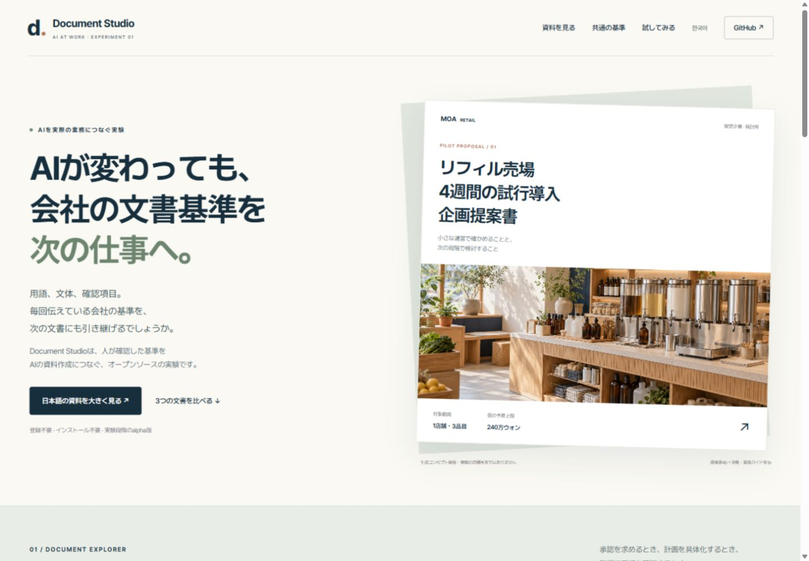
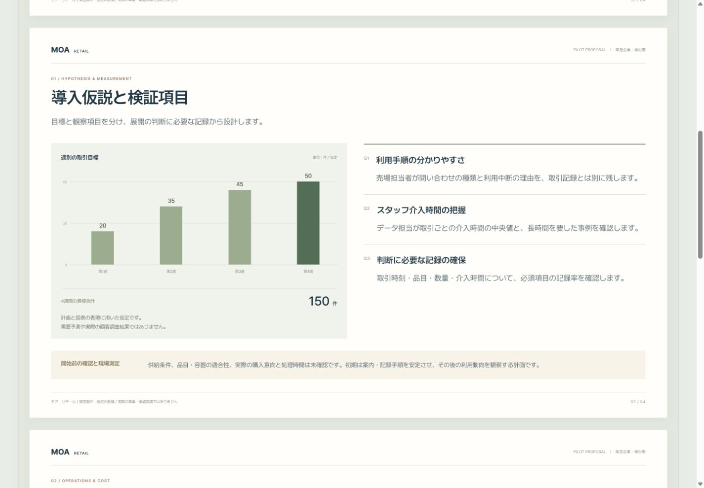

# 日本語の公開文書デモ

**同じ案件でも、読み手が変われば構成が変わります。** 架空の小売企業を題材に、企画提案書、決裁サマリー、業務ガイドを制作しました。

[日本語デモを開く](https://document-studio-public-experiment.wlehd00000.chatgpt.site/) · [日本語の導入](QUICKSTART_ja.md) · [한국어](https://document-studio-public-experiment.wlehd00000.chatgpt.site/ko) · [English](../README.en.md)

## 固定ルールを比較する

比較ビュー [compare](https://document-studio-public-experiment.wlehd00000.chatgpt.site/compare) は、同一の本文・予算・条件を3つの事前定義した様式で表示します。様式ごとの用紙、余白、本文、色、数値右揃えを、2ページと日本語・韓国語で維持します。

| 様式 | 固定する規則 |
|---|---|
| 白黒A4 | A4縦、余白18mm、本文11pt/1.6、黒・白のみ、画像なし |
| 整列レポート | A4縦、余白18mm、本文11pt/1.65、2列・列間6mm、限定色 |
| 横型提案 | A4横、余白15mm、本文11pt/1.6、本文・表と参考画像の分離 |

ページ、言語、比較する様式、表示倍率、ガイドはURLに保存されます。倍率は用紙全体を拡大縮小するもので、本文サイズのルールを変更しません。表示測定は2ページのCSS寸法、余白、本文・見出し、書体、色、数値整列、収まり、ヘッダー・フッター、本文の共通性を確認します。

これは作成済みの静的HTMLに対する表示確認です。新規生成の遵守率や実在企業のCompany Packの有効性を測定していません。3様式の規則はこの比較例のための事前定義です。

## 創造性を広げた1ページと、企画の深掘り

[**実験的・没入型の1ページを見る**](https://document-studio-public-experiment.wlehd00000.chatgpt.site/creative) · [**コンサルティング企画の進め方**](https://document-studio-public-experiment.wlehd00000.chatgpt.site/creative#consulting)

創造性の設定は、比喩・視点・大小関係・読む順序を変え、視覚表現の設定は色・質感・画像の存在感を変えます。この例は `showcase`（`experimental / immersive`）を採用。用語・数値・条件を保ち、同じ架空案件の要点をA4横1ページに再編集しました。既存の2ページ比較と全文が同一の例ではありません。生成コンセプト画像と、編集可能なタイトル・本文・数値を組み合わせています。

任意の**深掘りコンサルティング企画**では、AIが独立調査、反論と実際の文書事例の検討、論理構成の代案を示します。必要な場合は代表1〜2ページを早期試作し、執筆者が方向を選んだ後は調査と原稿を深めます。最終原稿を受け入れた後、通常のデザイン・出力・検証へ進みます。

創造性設定とは別の選択で、利用者が明示的に選んだ場合に使います。通常のお任せ制作にこの相談工程を追加しません。[仕様](../skills/report-html-pptx/references/editorial-consulting-mode.md)を参照してください。公開サイトは作成済みの例と機能紹介を表示するもので、実際の相談やAI生成を実行しません。

## 文書を大きく確認

| 文書 | 内容 | リンク |
|---|---|---|
| 企画提案書・4ページ | 範囲、仮説と測定、運営と費用、計画と判断 | [全ページ・拡大本文](https://document-studio-public-experiment.wlehd00000.chatgpt.site/example?doc=proposal&view=all&size=large) |
| 決裁サマリー・1ページ | 承認事項、先行条件、承認に含めない範囲 | [閲覧](https://document-studio-public-experiment.wlehd00000.chatgpt.site/example?doc=approval&view=all&size=large) |
| 業務ガイド・1ページ | 担当者、手順、例外、引継ぎ | [閲覧](https://document-studio-public-experiment.wlehd00000.chatgpt.site/example?doc=guide&view=all&size=large) |

文書専用ビューは、全ページ表示と1ページ表示、文字サイズ、共通基準表示を切り替えられます。登録やインストールは不要です。表示の切り替えでAIを実行するものではありません。

## 例の前提とソース

会社、目標、費用は仮定です。予算は240万ウォン（KRW）を維持し、円換算していません。画像は生成コンセプトで、実際の店舗・設置実績ではありません。

この例は独立して制作した静的HTMLです。Company Packの自動分析・適用結果、モデル間の同一品質、企業全体の生産性向上を実証したものではありません。[文書例のソースと確認条件](../showcase/README.md)を公開しています。

既存の小さな[韓国語HTML例](../skills/report-html-pptx/assets/accepted-staff-guide/index.html)と、架空の[小売](../company-packs/demo-retail/pack.json)・[製造業](../company-packs/demo-manufacturing/pack.json)のCompany Packも引き続き参照できます。これらの既存パックと、今回の画面例の制作基準は別です。

## 自分の環境で試す

[日本語の導入ガイド](QUICKSTART_ja.md)と[初回利用ガイド](TRY_FIRST.md)を参照してください。デモの閲覧と、スキルの導入、実際の文書生成、PPTX変換の検証は別工程です。

実際に作った資料や修正が必要だった点は、[初回利用のフィードバック](https://github.com/wlehd00000-cell/document-studio/issues/new?template=first_run.md)で共有できます。方向が役に立つと感じた場合は、GitHubのStarで保存してください。
