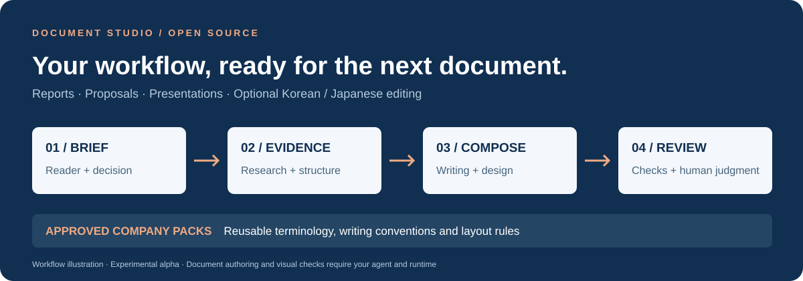

# Document Studio: look around before installing

**Make your document workflow reusable.** Document Studio is an MIT-licensed collection of agent skills and Python tools for reports, proposals, and presentations. It packages working conventions in readable files rather than requiring you to repeat them in every AI conversation.

[Try a small task](TRY_FIRST.md) · [한국어](QUICKSTART_ko.md) · [日本語](QUICKSTART_ja.md) · [Source](../skills/)

## Inspect an actual included example

The repository contains an independently authored **fictional Korean retail document**: a project brief, a synthetic target, and four work steps. This is an included composition example, not evidence of a new automatic generation or a real business result.

1. [Read its self-contained HTML source](../skills/report-html-pptx/assets/accepted-staff-guide/index.html).
2. To see it rendered, [download the HTML file](https://raw.githubusercontent.com/wlehd00000-cell/document-studio/main/skills/report-html-pptx/assets/accepted-staff-guide/index.html), save it as `document-studio-example.html`, and open it in a browser. It needs no JavaScript, AI account, plugin, or company upload. Fonts may differ on your computer.
3. [Inspect the fictional retail Company Pack](../company-packs/demo-retail/pack.json): the reusable style profile is separate from the document's content.

For a different starting point, inspect the [fictional manufacturing pack](../company-packs/demo-manufacturing/pack.json). These examples describe different visual and writing settings; they do not certify brand fidelity.

## What the workflow adds

| Repeated task | Reusable part |
|---|---|
| Explain who is reading and what decision they need | Intake and document architecture |
| Gather evidence and distinguish assumptions | Research workflow and source notes |
| Write, structure and design the document | Separate writing, design and visual-asset skills |
| Keep reviewed terminology and layout conventions | A Company Pack with approval records |
| Adapt business copy into Korean or Japanese | Two optional language skills |
| Prepare editable PowerPoint output | A separate HTML-to-PPTX workflow and dependencies |

The collection has **8 core skills + 2 optional language skills**. Read the [entrypoint](../skills/report-html-pptx/SKILL.md) to see how it routes a task.

## Try one fictional brief

Once the skills are installed, ask your agent:

> Use report-html-pptx. Make a two-page HTML proposal for a four-week employee onboarding pilot. The reader is an operations manager deciding whether to approve a $2,400 budget for 12 people. Include the recommendation, schedule, budget, three measures of success, and risks. Treat all figures as fictional. Tell me which checks you actually performed.

Check the decision, the arithmetic, the layout, and the agent's QA report. [Installation and prompts in three languages](TRY_FIRST.md).

## Choose a route

- **Codex:** from your own project folder, use the [documented skills CLI command](TRY_FIRST.md#fast-agent-skill-install). It installs skills; repository-level packaging tools are separate.
- **ChatGPT:** if your account supports Plugin Creator and saving plugins, use the [Starter ZIP instructions](TRY_FIRST.md#chatgpt). Downloading is not installation.
- **Team evaluation:** start with fictional materials and the [administrator guide](WORKSPACE_ADMIN_GUIDE.md).

## Current boundaries

This is an **experimental alpha toolkit**, not a hosted editor. Your agent and runtime do the authoring. Rendering, fonts, editable PPTX conversion and visual checks need their respective tools. Private-source Company Pack export and automatic workspace deployment are not supported. Output equivalence across AI models is not guaranteed. [Detailed status](WORKSPACE_ADMIN_GUIDE.md).

## Help shape the next version

Try the small fictional brief, then [share first-run feedback](https://github.com/wlehd00000-cell/document-studio/issues/new?template=first_run.md): your route, where you got stuck, and what you expected. Use public or synthetic examples.

If the project is useful, **[give Document Studio a star](https://github.com/wlehd00000-cell/document-studio)** so other document makers can discover it.
