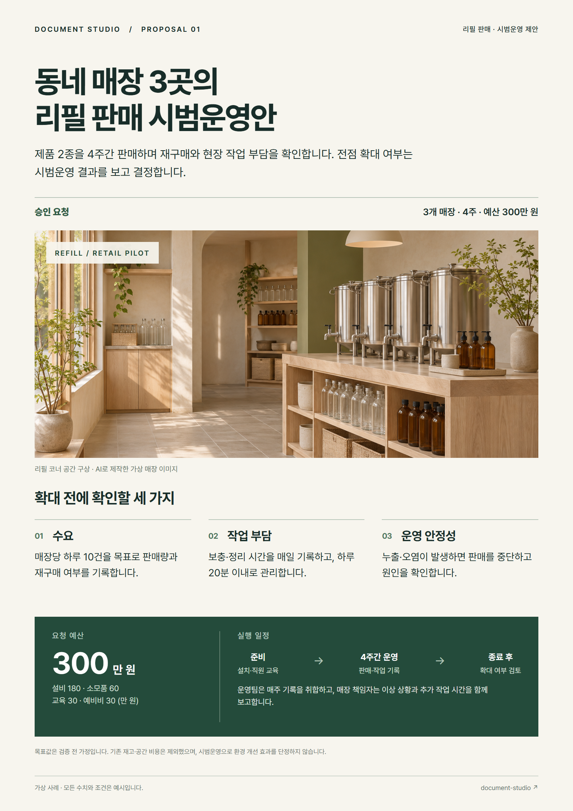
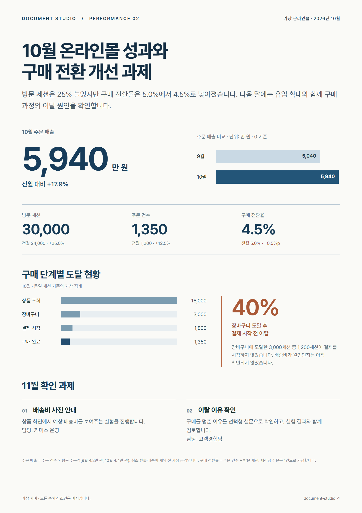
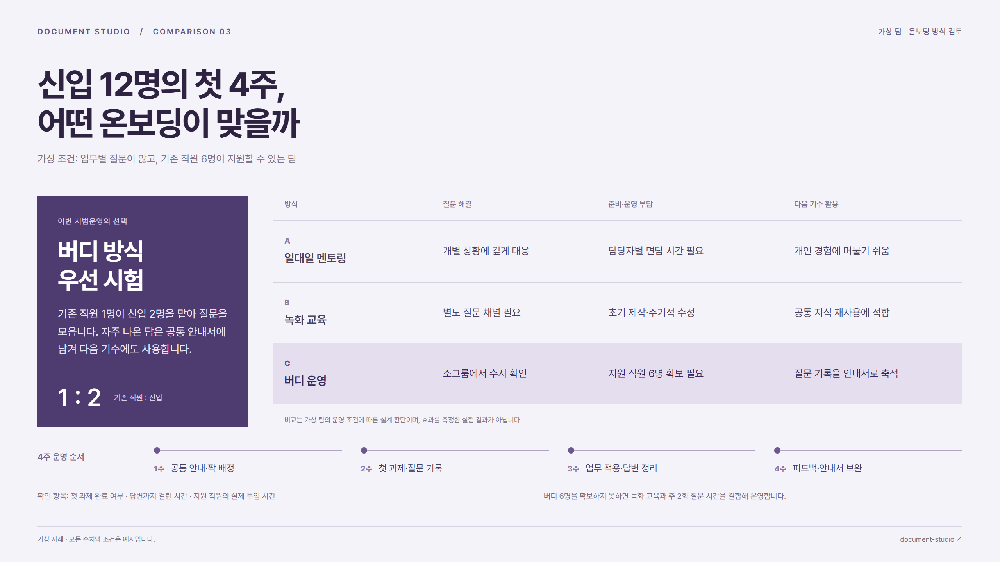
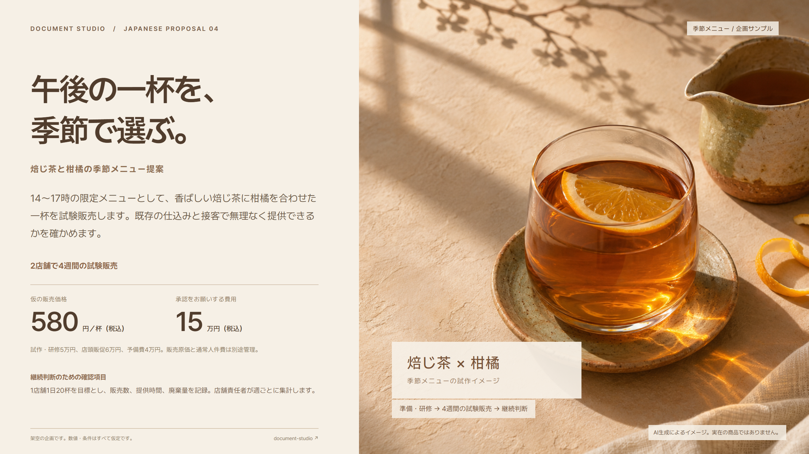

# Document collection

[Back to Document Studio](../../README.md) · [한국어](../../README.ko.md) · [日本語](../../README.ja.md)

Four fictional business documents, with editable source files. Select a full-size preview below or [open the four-page PDF](document-collection.pdf).

## 01 / Retail pilot proposal

**Korean · A4 portrait** — Approval scope, operating checks, budget, and schedule.

[PNG](png/01-refill-proposal.png) · [PDF](pdf/01-refill-proposal.pdf) · [Editable HTML](html/01-refill-proposal.html) · [Copy source](source/01-refill-proposal.json)

## 02 / Monthly performance report

**Korean · A4 portrait** — Revenue, purchase conversion, drop-off, and follow-up actions.

[PNG](png/02-commerce-report.png) · [PDF](pdf/02-commerce-report.pdf) · [Editable HTML](html/02-commerce-report.html) · [Copy source](source/02-commerce-report.json)

## 03 / Onboarding comparison

**Korean · 16:9 landscape** — Three ways to onboard a team, with a recommendation and a four-week plan.

[PNG](png/03-onboarding-comparison.png) · [PDF](pdf/03-onboarding-comparison.pdf) · [Editable HTML](html/03-onboarding-comparison.html) · [Copy source](source/03-onboarding-comparison.json)

## 04 / Seasonal menu proposal

**Japanese · 16:9 landscape** — A seasonal drink concept with pricing, trial conditions, and a budget request.

[PNG](png/04-seasonal-menu-ja.png) · [PDF](pdf/04-seasonal-menu-ja.pdf) · [Editable HTML](html/04-seasonal-menu-ja.html) · [Copy source](source/04-seasonal-menu-ja.json)

## Edit or reuse a sample

GitHub displays HTML source rather than running it. Download the repository using **Code → Download ZIP**, extract it, and open `examples/document-collection/index.html` in your browser. Keep the `html/`, `assets/`, `png/`, and `pdf/` folders together. There is no server or build step for this collection.

Text, numbers, tables, and layout live in HTML; the copy is also stored as JSON. The store and drink visuals are separate image files. After changing any figures or wording, regenerate and recheck the relevant output.

## Production notes

Prepared in November 2026 and reviewed on 14 November 2026. These examples were authored and revised in a guided session with a separate, **author-maintained document workflow**, with its company branding removed. They are curated design examples, not an unedited one-shot result or an independent fresh-install benchmark of the public Document Studio package. No private company material was used.

- All companies, situations, figures, targets, and operating conditions are fictional.
- Store and drink visuals were created with the built-in image generator. They are concepts, not photographs of real products or premises.
- Native HTML holds the copy, figures, and charts; text was not baked into the generated photographs.
- HTML and PDF pages were visually inspected. Checks covered arithmetic, source-copy coverage in extracted PDF text, page size, font loading, and overflow.
- Formats: two A4 portrait documents and two 16:9 landscape slides. PNGs are 1588 × 2246 or 2560 × 1440 pixels. PDF text is selectable.
- Physical printing, rendering on other devices, and editable PPTX conversion were not checked for this collection.

## Rights

Original collection material is distributed under the repository's [MIT license](../../LICENSE). Bundled Pretendard fonts retain their [SIL Open Font License](assets/LICENSE-Pretendard.txt). See the [third-party notices](../../THIRD_PARTY_NOTICES.md).
