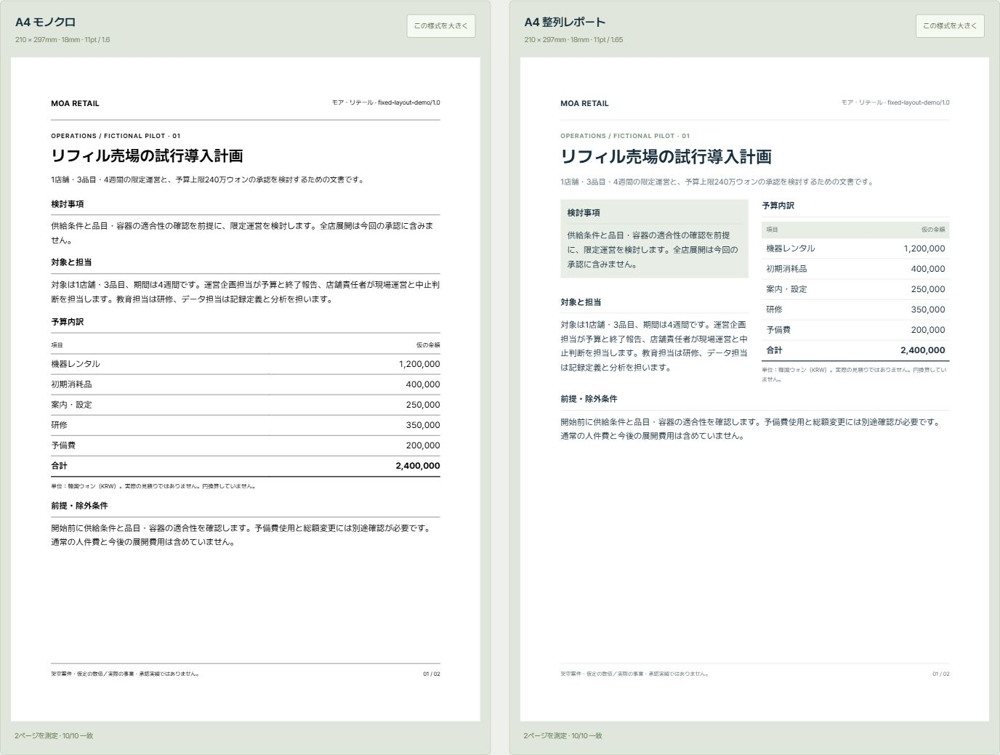
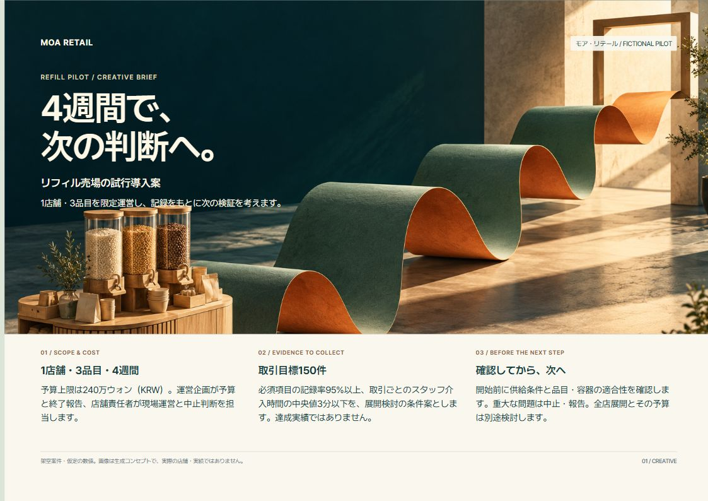
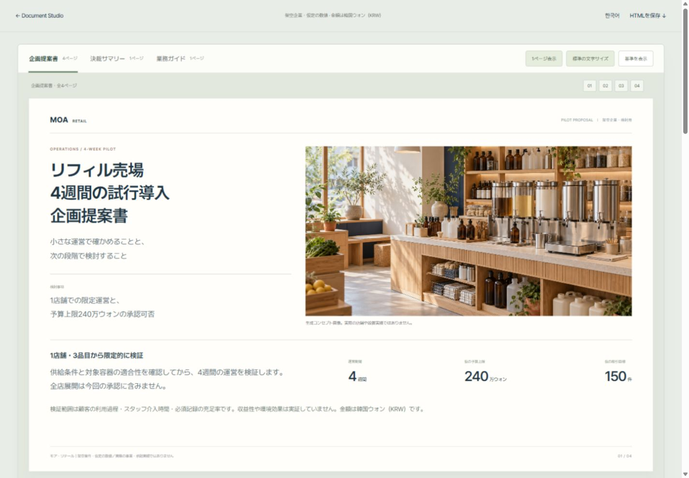
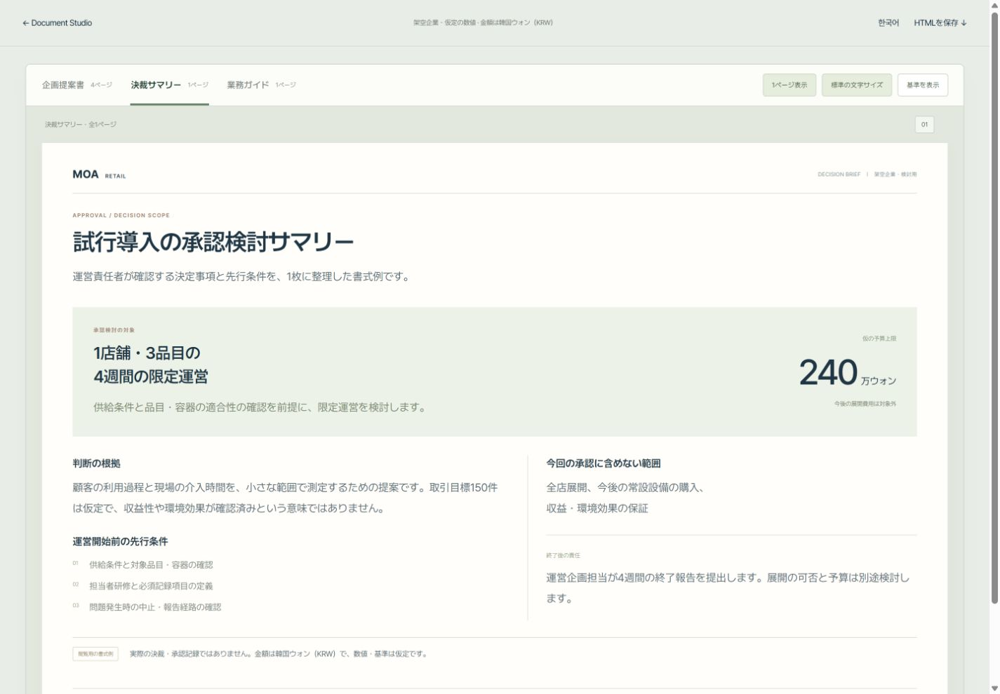
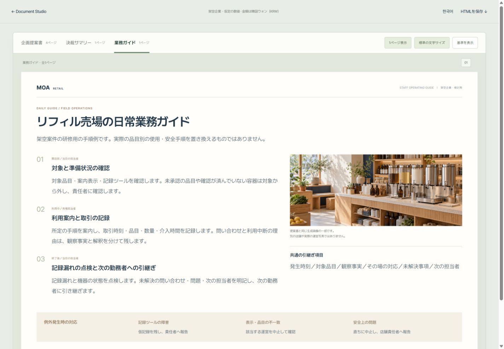

# 公開文書例のソースと確認条件

日本語を主言語とする、インストール不要のHTMLショーケースです。

[公開サイト](https://document-studio-public-experiment.wlehd00000.chatgpt.site/) · [日本語の文書を全ページで表示](https://document-studio-public-experiment.wlehd00000.chatgpt.site/example?view=all&size=large) · [韓国語版](https://document-studio-public-experiment.wlehd00000.chatgpt.site/ko)

## 固定ルールを比較する

比較ビュー [compare](https://document-studio-public-experiment.wlehd00000.chatgpt.site/compare) は、同一の本文・予算・条件を3つの事前定義した様式で表示します。様式ごとの用紙、余白、本文、色、数値右揃えを、2ページと日本語・韓国語で維持します。

| 様式 | 固定する規則 |
|---|---|
| 白黒A4 | A4縦、余白18mm、本文11pt/1.6、黒・白のみ、画像なし |
| 整列レポート | A4縦、余白18mm、本文11pt/1.65、2列・列間6mm、限定色 |
| 横型提案 | A4横、余白15mm、本文11pt/1.6、本文・表と参考画像の分離 |

ページ、言語、比較する様式、表示倍率、ガイドはURLに保存されます。倍率は用紙全体を拡大縮小するもので、本文サイズのルールを変更しません。表示測定は2ページのCSS寸法、余白、本文・見出し、書体、色、数値整列、収まり、ヘッダー・フッター、本文の共通性を確認します。

これは作成済みの静的HTMLに対する表示確認です。新規生成の遵守率や実在企業のCompany Packの有効性を測定していません。3様式の規則はこの比較例のための事前定義です。

## 創造性を広げた1ページと、企画の深掘り

[**実験的・没入型の1ページを見る**](https://document-studio-public-experiment.wlehd00000.chatgpt.site/creative) · [**コンサルティング企画の進め方**](https://document-studio-public-experiment.wlehd00000.chatgpt.site/creative#consulting)

創造性の設定は、比喩・視点・大小関係・読む順序を変え、視覚表現の設定は色・質感・画像の存在感を変えます。この例は `showcase`（`experimental / immersive`）を採用。用語・数値・条件を保ち、同じ架空案件の要点をA4横1ページに再編集しました。既存の2ページ比較と全文が同一の例ではありません。生成コンセプト画像と、編集可能なタイトル・本文・数値を組み合わせています。

任意の**深掘りコンサルティング企画**では、AIが独立調査、反論と実際の文書事例の検討、論理構成の代案を示します。必要な場合は代表1〜2ページを早期試作し、執筆者が方向を選んだ後は調査と原稿を深めます。最終原稿を受け入れた後、通常のデザイン・出力・検証へ進みます。

創造性設定とは別の選択で、利用者が明示的に選んだ場合に使います。通常のお任せ制作にこの相談工程を追加しません。[仕様](../skills/report-html-pptx/references/editorial-consulting-mode.md)を参照してください。公開サイトは作成済みの例と機能紹介を表示するもので、実際の相談やAI生成を実行しません。

## 収録内容

| 文書 | 目的 | ページ |
|---|---|---|
| 企画提案書 | 範囲・仮説・予算・実行・終了後の判断 | P1–P4 |
| 決裁サマリー | 承認する事項と除外範囲 | A1 |
| 業務ガイド | 手順・担当・例外・引継ぎ | G1 |

## 開き方と操作

`compare.html` は固定ルールの比較ビューです。[design-contracts.json](design-contracts.json) が規則、[comparison-data.js](comparison-data.js) が共通の本文、[comparison.js](comparison.js) が表示と測定、[comparison.css](comparison.css) が組版です。

このフォルダーの `index.html` は紹介ページ、`example.html` は文書専用ビューです。クローンしたファイルはブラウザーで開けます。公開版では次のURLを使用します。

- `example?doc=proposal&view=all&size=large`：提案書を大きめの文字で連続表示。
- `example?doc=approval&view=all&size=large`：決裁サマリー。
- `example?doc=guide&view=all&size=large`：業務ガイド。
- `view=one&page=2`：選択した文書の2ページ目を1ページずつ表示。
- `ko` / `example-ko`：韓国語の紹介と文書例。

日本語ビューでは、文書タブ、全ページ／1ページ表示、文字サイズ、共通基準表示を切り替えられます。韓国語版は従来の1ページずつの表示です。文書専用ビューでは設定がURLに反映されます。依頼文のコピーはブラウザーの許可と実行環境によって利用できない場合があり、その際は選択してコピーする案内を表示します。

日本語本文は [documents-ja.js](documents-ja.js)、韓国語本文は [documents.js](documents.js)、共通の文書レイアウトは [demo.css](demo.css) です。外部API・アカウント・アップロードは使用しません。このフロントエンドはAIモデルを呼び出さず、作成済みの文書を切り替えて表示します。

## 事実・仮定・確認状態

この文書例は、公開用に独立して制作した架空案件です。実際の会社資料の分析、承認済みCompany Packの自動適用、新しいモデルでの生成試験、企業全体の生産性改善を再現・実証したものではありません。

- モア・リテールは架空企業です。対象は1店舗・3品目・4週間です。
- 予算上限は240万ウォン（KRW）。120万＋40万＋25万＋35万＋20万ウォンの合計です。円換算していません。
- 取引目標は20＋35＋45＋50＝150件です。実際の顧客調査や達成実績ではありません。
- 記録率95%以上、介入時間の中央値3分以下などは提案した検討基準です。
- 展開、収益性、環境効果を承認済み・実証済みと扱いません。供給条件と品目・容器の適合性は確認前提です。
- コンセプト画像は生成AIで制作したものです。ガイドに使用した画像は、表紙と同じ原本の一部です。

日本語化では、見出し・本文・図表・注記・金額・担当・除外範囲・未確認状態を対照しました。表示の確認と、実際の業務への採用・成果の検証は別です。PowerPointや印刷結果はこのショーケースでは検証していません。

## ライセンス

独自のHTML・CSS・JavaScriptは[MIT](../LICENSE)。[Pretendard / Pretendard JPのOFL表示](assets/LICENSE-Pretendard.txt)を同梱しています。これらのフォントファイルは、この独立した公開ビューのために `showcase/assets/` に配置しており、スキル本体のフォント導入を代替するものではありません。

## 公開例の確認記録

この比較例では両ページの用紙・余白・本文／見出しサイズ・書体・ネイティブ色指定を測定します。表の数値は右揃えです。本文領域同士の矩形の重なりと、ヘッダー／タイトル／本文／フッターの順序も確認します。これはページの内容の正しさや、実際の生成処理を保証するものではありません。

2026-11-02のブラウザー確認では、3様式×2ページ×日本語／韓国語の各様式について10項目が一致しました。390px幅でページ全体に横はみ出しがなく、100%表示の横スクロールが用紙内に限定されることも確認しました。印刷・PPTXは未検証です。
